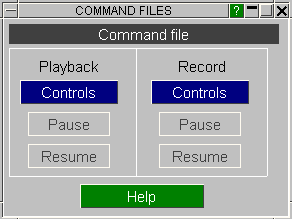

###  CFILE Invoking the Command-File Launcher Box

Recording and replaying files are controlled from separate windows that are "launched" from the "Command Files" launcher box.

This can also be used during the operation of these files, see [here](using-the-launcher-box-during-recording-and-playback.md#launcher).

Previous: compatibility-with-files-from-earlier-releases-of-d3plot  |  Next: recording-files