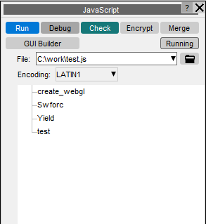
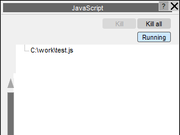

###  Compiling and Running a script

|  | | Run | will both compile and run the script unless it contains syntax errors, in which case it stops with an error message when compilation fails. | | --- | --- | | Debug | Starts the JavaScript debugger, JaDeto debug the script. | | Check | only compiles the script, reporting any errors found, and does not run it. | | Encrypt | A script can be encrypted so that the source code is hidden but the script can still be run (when compiling and running the script D3PLOT decrypts the file in memory). Once encrypted the source code cannot be retrieved by an ordinary user so make sure that you keep the original file somewhere safe. As a last resort contact Oasys Ltd Support who can decrypt the script if required.  If a script is split up into separate files by Use the files are all combined together into the main file before encrypting. | | Merge | If a script is split up into separate files by Use the files are all combined together into a single file. This may be useful if you want to give the script so someone else and you do not want to have to give lots of different files. | | GUI Builder | Opens the GUI Builderto interactively build GUIs for your script. | | Running | Enables you to view (and kill) any scripts that are currently running | |
| --- | --- |

### Knowing which scripts are running

When scripts are running in D3PLOT, they are shown in the Running submenu.

Use the Running button to toggle between the list of scripts that are currently running, and the tree of available scripts.

To kill/terminate a running script, highlight the script(s) in the tree and press Kill.

Alternatively, to kill all the scripts that are currently running use Kill all.
Previous: using-javascript-in-d3plot  |  Next: dealing-with-errors-in-scripts