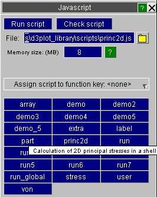

###  Maintaining a library of JavaScripts

It is also convenient to have a library of scripts in a defined location.

By default D3PLOT looks in $OASYS/d3plot\_library/scripts , but you can define a different directory by setting the preference:

d3plot\*script\_directory: *some\_different\_directory\_name*

In the your oa\_pref file.

All scripts found in the relevant directory will be listed in the JavaScript panel, as shown in this example.

 
  **Using the "description:" comment at the top of a script to identify its purpose**

To help to identify scripts special comments are searched for in the top 10 lines of each script, and if description: is found, for example the comment line:

// description:  *Some description of the script's purpose*

Then the description line is shown as hover text when the mouse is placed over that filename. In the example above the " princ2d " script has the line

// description: Calculation of 2D principal stresses in a shell

 **Using the "name:" comment at the top of a script to change its name**

Normally the name shown for a script will be its filename, stripped of any leading pathname and trailing ".js" extension.

However if the string name: is found in the first ten lines of the script, then the following name will be used instead. For example the line:

// name: temporar y

Will result in the script appearing with the name " temporary " in tha JavaScript panel. This does not affect the actual name of the script, only the name on its library button.

####  Using the "memory:" comment at the top of a script to change the initial garbage collection memory

Very occasionally the **initial**memory required for garbage collectionneeds to be changed.

If the string memory: is found in the first twenty lines of the script, then the size given will be used for the initial garbage collection memory. For example the line:

// memory: 50

Will result in the script **initially** using 50Mb for garbage collection memory. D3PLOT will automatically expand the memory required for garbage collection as necessary. See Garbage Collection Memory Size for more details.

####  Using the "encoding:" comment at the top of a script to change the encoding

By default the encoding used for scripts is LATIN1

If the string encoding: is found in a comment on the first twenty lines of the script, then the encoding will automatically be used for the script. The allowed values are UTF8 or UTF-8 for UTF- 8 encoding and ShiftJIS , Shift-JIS or sjis for Shift-JIS encoding.

For example the line:

// encoding: UTF8

Will result in the UTF-8 encoding being used for the script.

####  Using the "module:" comment at the top of a script for ES6 modules

D3PLOT has to compile scripts that use ES6 modulesdifferently to 'normal' scripts. If a script has the extension .mjs then D3PLOT will automatically compile the script to use ES6 modules. Alternatively, if the file has a different extension, the module comment can be used to tell D3PLOT that this file needs to be compiled to support ES6 modules.

If the string module: TRUE is found in a comment on the first twenty lines of the script, then the script will be compiled with ES6 module support.

For example the line:

// module: TRUE

Will result in the script being compiled with ES6 module support.

Previous: assigning-javascripts-to-function-keys  |  Next: running-a-javascript-in-batch-mode