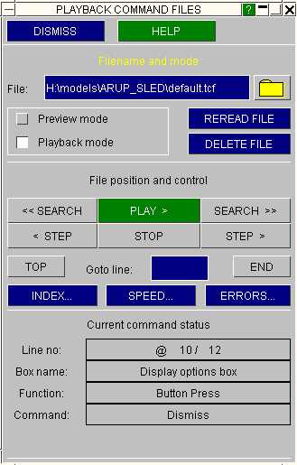
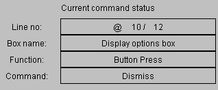
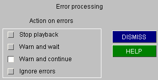

###  Playing back files

This figure shows the command file playback control panel.

To use it you must first enter a command filename in the File: box. This is read in and converted into internal form, and the command buttons will then become live.

To execute commands continuously you use the PLAY &gt; button. This can be halted with the STOP button. STEP executes commands one at a time.

It has two modes:

Playback Executes commands. This is the default.

Preview Previews commands without executing them.
 

| How command files are processed   Commands are stored in an internal scratch file that, as with "record" mode, is like a tape in a tape recorder. Each command forms a separate line, and you can move the "tape" back and forth to locate it at any line. |
| --- |

When in Playback mode you can PLAY your commands. Each command from the current position to &lt;end of file&gt; is executed as if you had typed it in, screen-picked it, etc. To stop a playback prematurely use the STOP button.

By default a PLAY operation operates at full speed, but you can introduce a delay between commands using the SPEED... options. This can be useful if you want to interrupt a sequence at a particular point, and if full speed playback is too fast to follow.

| The current command is always shown in the Current command status box. In the example here we are currently at command #10 (out of 12 in the file), which is a DISMISS button press. |  |
| --- | --- |

| Previewing commands   The playback control panel can be operated in Preview (instead of Playback ) mode. This allows you to view commands without actually executing them, and thus to position yourself where you want in the file. |  |
| --- | --- |

The PLAY &gt; button is replaced by a PREVIEW &gt; one to remind you which mode you are in. Commands are listed in the Current command status box as above, and you can STEP backwards and forwards as before. These and the other positioning and searching commands operate in exactly the same way as for recording files: see [here](recording-files.md#reviewing)for more detailed instructions.

| Handling errors during playback   When you are playing commands it is possible to generate errors. Examples might be playing back commands recorded in a model with 10 materials in a different one with only five materials. If the screen button corresponding to the (non-existent) 10th material is picked in some context (eg from a menu) an error will occur. |
| --- |

| The ERRORS... command lets you set the action to be taken when errors occur.   The Action on errors options are shown here, with the default Warn and continue option set.   The other options are self-explanatory.   [This](more-information-about-command-files.md#moreinfo)gives more information about how errors may occur, and how to avoid them. |  |
| --- | --- |

| Opening new command files   You can read in a new command file at any time, or reread the current one (assuming it has been updated on disk).   In either case **all** existing commands in the internal scratch file are deleted and superseded by those read in. You cannot concatenate the contents of the new file with the existing one. |
| --- |

| Recording files during command file playback   This is quite legal. The two operations are quite separate, and commands executed from a command file will be recorded exactly as if they had been typed in. This is the recommended method of editing and appending to files. |
| --- |

Previous: recording-files  |  Next: using-the-launcher-box-during-recording-and-playback