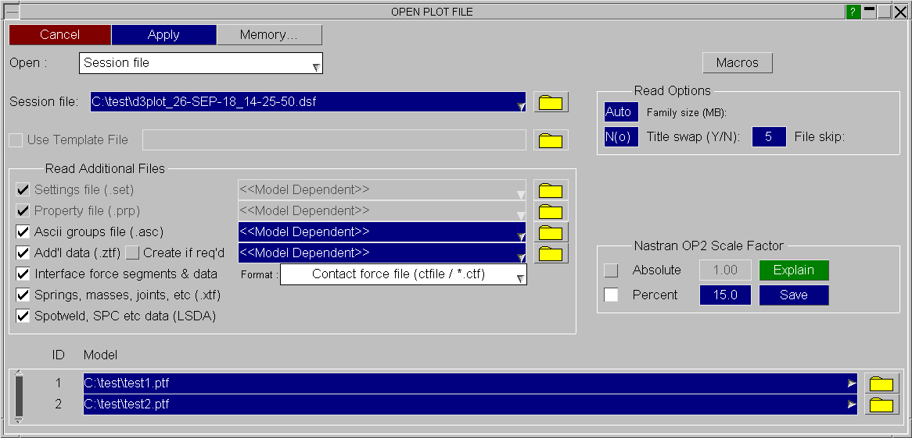

####  Reading Session Files in a new session

 
 
On the New Model panel you can choose to read any Session File. This must be done before reading in a model..
 
The most recently saved session file names can be accessed using the appropriate recent files popup. Both explicitly saved sessions and auto-saved sessions will be listed.
 
Result file names may be changed using appropraite textboxes or file selectors in order to load results from alternate iterations.

Previous: saving-sessions  |  Next: external-data