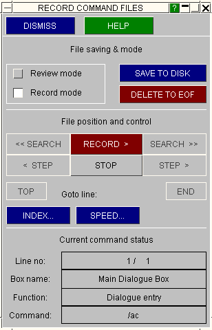
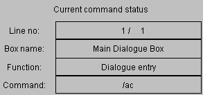
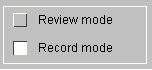
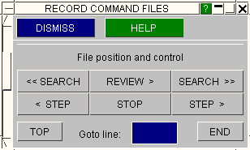
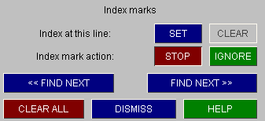

###  Recording files

This figure (right) shows the RECORD control panel.

The [RECORD] CONTROLS... button in the launcher box maps this panel, which manages the recording of commands.

It works exactly like a tape-recorder: you can use the RECORD button to switch on recording, and all subsequent commands are recorded until it is turned off again by STOP .

It has two modes:

Record Actually records commands. This is the default.

Review Allows you to go back and forth to review recorded commands.
 

| How files are recorded   When in Record mode, with the RECORD button depressed, every command, screen-pick, button press, etc (except those in the command file control panels) is recorded in an internal file. You could think of this as being the tape of a video recorder, with each video "frame" representing a command. |
| --- |

| As each command is stored it is also reported in the Current command status area at the base of the box.  Each command ha a unique line number, and in this example line #1 (out of 1 line recorded so far) is the command /ac in the dialogue box. |  |
| --- | --- |

| Reviewing stored commands   If you switch from Record mode to Review mode then you will find that all the tape recorder buttons become live, and that (implicitly) command recording stops. You will also note that the RECORD button becomes a REVIEW button: |  |
| --- | --- |

| In review mode you can list stored commands using the commands shown here. |  |
| --- | --- |

| REVIEW &gt; | Plays the recorded commands forwards from the current position, listing them in the Current command status box as described above. A time delay of 1 second between commands is left by default, but you can alter this using the SPEED... options. STOP halts this process. |
| --- | --- |
| STEP &lt; & &gt; | Respectively step backwards and backwards a single command. |

| SEARCH &lt;&lt; & &gt;&gt; | Respectively search backwards and forwards for a specified command.    You can search for any permutation of box name, function or dialogue string.    The options shown here are presented to you when you use either SEARCH button. It is recommended that you use the [ ? ] buttons to identify boxes or functions from menus, as these will get the syntax right. Command string searches are not case sensitive. |
| --- | --- |
| TOP & END | Will take you to line #1 and the last line respectively. |
| Goto line: | Will take you to the line number you specify. |

| Editing and overwriting commands   When you switch back into Record mode and start recording commands again, they start being recorded at the current position in the file. So if you have moved backwards during a Review , then start recording, you will overwrite commands stored at that point - just as would happen in an ordinary tape-recorder. |
| --- |

| Commands are overwritten on a line-by-line basis. Consider this example: |
| --- |
| <ul> <li>You record 20 commands. </li> <li>You go back to line #13 in review mode. </li> <li>You record 4 commands starting at line #13. </li> </ul> |

In this situation the original four commands (#13 to #16) will be overwritten, but commands #17 to #20 will be unchanged.

To delete commands from the current position to end of file use the DELETE TO EOF button.

It is possible to edit command files using a text editor. WE recommend using command-line commands where these are available. These can be inserted in the file amongst button-click commands. To find out about the command-line menu system, type H or M in the dialogue box.

| Inserting index marks   You can put markers, "index marks", on any line in your file. These have no command significance, but are useful as targets for search operations. The INDEX... command options are shown here. Index marks can be SET and CLEAR ed, and you can search for them in either direction with the FIND NEXT &lt;&lt; & &gt;&gt; buttons. |  |
| --- | --- |

| Writing out files   Files are stored as internal scratch files, and must be written out to disk in ASCII form before they can be read back in. This is done by the SAVE TO DISK command. |
| --- |

| **WARNING:** | **If you record a file, and then exit D3PLOT without issuing the SAVE\_TO\_DISK command, your recorded commands will be lost.** |
| --- | --- |

The format of the ASCII file, and advice on editing it, is given [here](more-information-about-command-files.md#moreinfo).

Previous: cfile-invoking-the-command-file-launcher-box  |  Next: playing-back-files