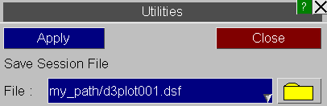
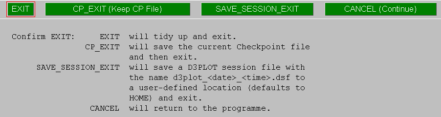

####  Saving sessions

| **Saving via the 'Session file' panel.** | Stores all relevant information in one session file (" .dsf ").   The default filename " d3plot *nnn*.dsf " is recommended, although any user-defined filename may be used.    |
| --- | --- |
| **Saving via the SAVE\_SESSION\_EXIT option during exit** | Clicking SAVE\_SESSION\_EXIT will save a session fle with a default name with the format d3plot\_&lt;date&gt;\_&lt;time&gt;.dsf . The file will be saved in the home directory by default but the location can be controlled using preferences.    |
| **Saving a session unconditionally upon exit** | The preference d3plot\*session\_auto\_save , when set to ON, will automatically write out a session file every time D3PLOT exits. These automatic session files will carry the name d3plot\_&lt;date&gt;\_&lt;time&gt;.dsf .   The save location may be controlled by using the preferences d3plot\*session\_save\_option and d3plot\*session\_save\_dir . |

Previous: utilities-session-file  |  Next: reading-session-files-in-a-new-session