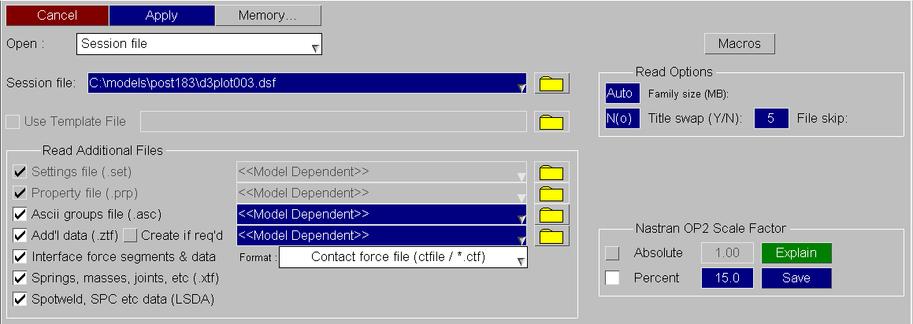
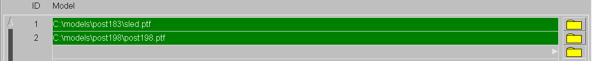

###  Session File

From D3PLOT 16.0 onwards, a D3PLOT session file may be saved and later restored, as is, to return users to the previous state. The session file contains information including results filenames, window and page layout, and model properties.

If the session file was saved while the D3PLOT-&gt;T/HIS link (see T/HIS the D3PLOT &lt;=&gt; T/HIS link ) was running then the session file will also contain information of the number of T/HIS graphs and it will contain a T/HIS FAST-TCF script which will regenerate the graphs contents.

This option can be used to reload a version 16 session file and to restore previously loaded models, window layouts and model-specific information.
 

 
Similar sets of results corresponding to different runs may be chosen using the model selection part of the menu.
 

Previous: open-new-model-opening-a-new-model-file  |  Next: basic-animation-the-current-state-and-selecting-states