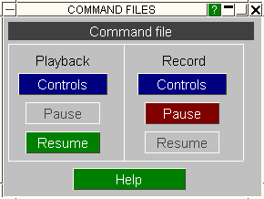

###  Using the "Launcher" Box During Recording and Playback

This figure shows the "launcher" box part of the way through a simultaneous record and playback session.

This box need not be mapped, but it can be useful to use it rather than the full control panels since it uses less space.

The "launcher" box always echos the PLAYBACK/STOP status of the playback box if a command file is resident in memory.
  
It also echos the RECORD/STOP status of the record box if that is in use.

Since the main panels for these two operations take up a lot of space on the screen you can use the simple on/off functionality provided by the "launcher" box instead.

| Think of it as a primitive remote control that can only has a "pause" function. It operates as follows: |
| --- |
| **During Playback:** | When you are in PLAY mode the PAUSE button will be available, and you can press it to pause playback.   Once pressed, as in the example above, it will be greyed out and the RESUME button made available instead. This, obviously, continues the playback. |
| **During Recording:** | When RECORD is on, as in the example here, the PAUSE button is live. If pushed it suspends recording, and subsequent commands will not be recorded until RESUME is pressed. |

In either case you can of course invoke the main control panels and override these buttons.

When recording or playback are not active then the buttons on this panel will be greyed out: they only become "live" when they might be needed.

Previous: playing-back-files  |  Next: more-information-about-command-files