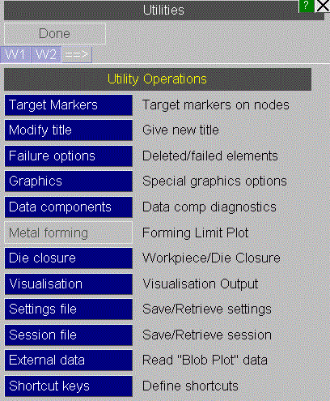

###  UTILITIES, SESSION_FILE

The "session" file (extension .dsf ) stores results file information, programme and window status information, and model properties.

Its purpose is to allow you to save a particular D3PLOT state and to then quickly restore D3PLOT back to said state at a later time by loading a single file.

Session files may also be loaded while choosing results from a different iteration. Clearly, the results need to be similar to the data that is embedded in the session file in terms of geometry and entity list and numbering.

The session file stores the number of graphics windows, and for each window:

* State selection for XY data, envelope plots.
* The current view.
* The background, text and hidden infill colours.
* The current ENTITY and LABEL settings.
* The current data component information and plotting mode.
* The current contouring settings and colours.
* Any cut-section data.
* Any fixed node, shift deformed and reference data.
* Lighting and shading information.
* Most DISPLAY\_OPTIONS settings.
* Other miscellaneous data.

Session files may only be loaded into an empty D3PLOT session where no models are pre-loaded.
 
Previous: reading-settings-and-properties-files-with-a-new-model  |  Next: saving-sessions